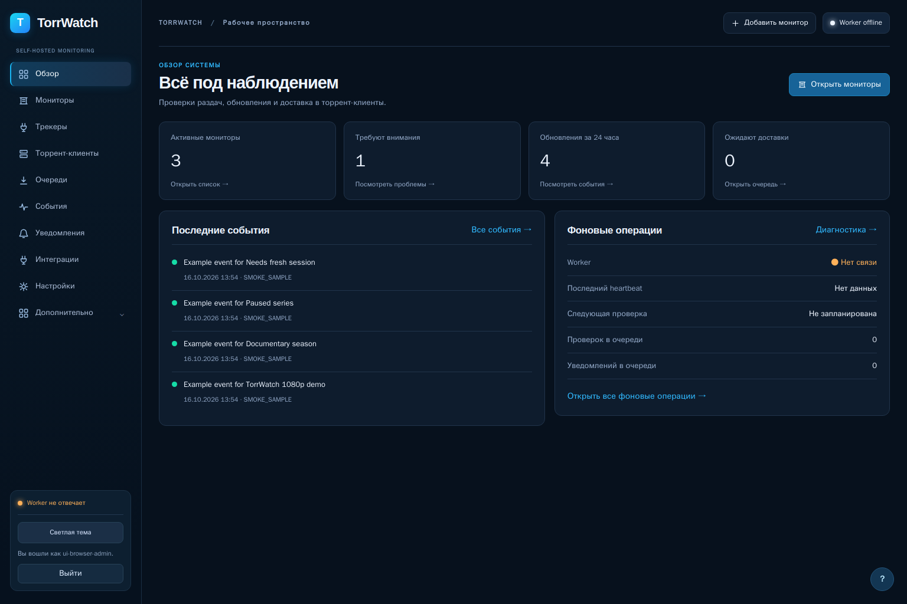
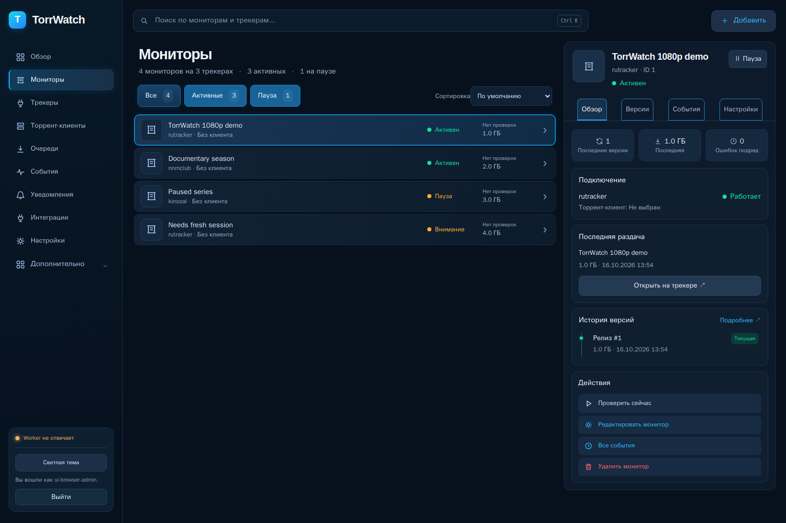
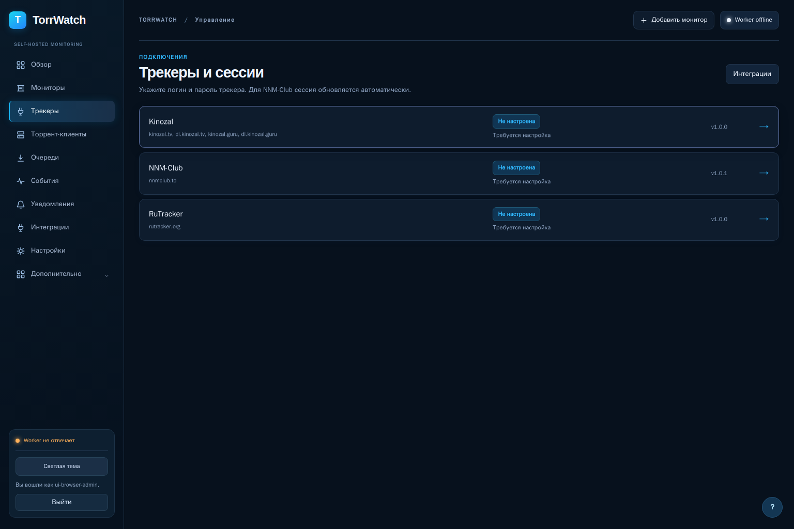

# TorrWatch — автоматический мониторинг обновлений торрент-раздач

TorrWatch — self-hosted сервис для домашнего сервера или NAS, который следит за конкретными страницами раздач на торрент-трекерах и автоматически доставляет обновления в торрент-клиент.

Проект рассчитан на сценарий «добавил раздачу один раз — дальше система сама проверяет её и сообщает об обновлениях».

## Что умеет TorrWatch

- проверять страницы раздач по расписанию;
- обнаруживать новые версии torrent-файлов и сохранять историю изменений;
- работать с плагинами трекеров;
- доставлять обновления в Transmission и qBittorrent;
- удалять старую задачу из торрент-клиента после добавления новой, не удаляя скачанные данные;
- автоматически обновлять названия и метаданные мониторов;
- отправлять уведомления в Telegram и Webhook;
- фильтровать уведомления по тегам мониторов;
- обновлять технические сессии через FlareSolverr для защищённых трекеров;
- показывать очереди, события, ошибки и состояние worker;
- хранить пароли, токены и сессии в зашифрованном виде.

## Как это работает

```text
Страница раздачи
        ↓
Проверка worker по расписанию
        ↓
Новая версия torrent-файла
        ↓
Доставка в Transmission / qBittorrent
        ↓
Telegram или Webhook уведомление
```

Первая успешная проверка создаёт baseline и не считается обновлением. Если идентичность torrent-файла изменилась, TorrWatch сохраняет новую версию, ставит доставку в очередь и отправляет уведомление.

## Интерфейс

Главный экран показывает состояние системы, активные мониторы и последние события:



Список мониторов содержит статус, дату последней проверки, клиент, размер текущей версии и теги:



Подключения, трекеры, сессии, торрент-клиенты и пути хранения настраиваются отдельно:



## Уведомления по тегам

Мониторам можно назначать теги, например:

```text
сериалы, Турецкие сериалы, избранное
```

Канал Telegram без тегов получает все события. Канал с тегами получает только события мониторов, у которых есть соответствующий тег. Тег из нескольких слов вводится как одна фраза, а несколько тегов разделяются запятыми.

В уведомлении можно увидеть название раздачи, трекер, размер, количество файлов, торрент-клиент, путь и тип события.

## Очереди и диагностика

Проверки, доставки и уведомления выполняются асинхронно через worker. В интерфейсе доступны:

- текущие активные операции;
- повторяемые и постоянные ошибки;
- количество попыток;
- даты создания, запуска и завершения;
- время следующей попытки;
- история последних операций;
- журнал событий с рекомендациями по исправлению.

Типовые технические ошибки в интерфейсе переводятся на русский, а исходные подробности сохраняются для диагностики.

## Архитектура

Проект состоит из нескольких контейнеров:

- `web` — веб-интерфейс и административные действия;
- `worker` — проверки трекеров, доставка и уведомления;
- `flaresolverr` — браузерное прохождение Cloudflare при необходимости.

Состояние хранится в SQLite и каталоге данных Docker Compose. Очереди позволяют переживать перезапуск контейнеров и повторять временно неудачные операции.

## Запуск

```bash
git clone https://github.com/Any1Key/torrwatch.git
cd torrwatch
cp .env.example .env
docker compose pull
docker compose up -d
```

После запуска интерфейс доступен на `http://localhost:8080`.

Готовый образ публикуется в Docker Hub:

```text
ruslanchikt/torrwatch:latest
```

## Важно знать

TorrWatch не ищет раздачи по трекеру и не является каталогом. Каждый монитор добавляется явно по URL конкретной страницы. Проверки зависят от доступности трекера, авторизации, сети, FlareSolverr и торрент-клиента.

Проект предназначен прежде всего для домашнего использования, NAS и небольших локальных серверов.

## Ссылки

- Исходный код: https://github.com/Any1Key/torrwatch
- Docker Hub: https://hub.docker.com/r/ruslanchikt/torrwatch
- Лицензия: MIT
